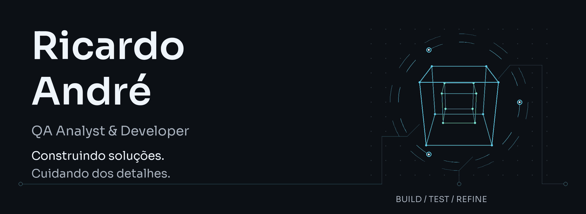

<picture>
  <source media="(prefers-reduced-motion: reduce) and (max-width: 600px)" srcset="assets/hero-mobile.png">
  <source media="(prefers-reduced-motion: reduce)" srcset="assets/hero.png">
  <source media="(max-width: 600px)" srcset="assets/hero-mobile.gif">
  
</picture>

Sou **Analista de Testes e Qualidade na DTec/UNIFOR** e estudante de **Ciência da Computação**. Trabalho com testes funcionais, automação e performance — e também gosto de transformar ideias em software.

### Projetos selecionados

**[Bothoven ↗](https://github.com/Dedezaao/Bothoven_Bot-Discord)**  
Bot musical para Discord, feito em Elixir, com integração a APIs e persistência de favoritos.

**[Projeto Gravata ↗](https://github.com/Dedezaao/SiteJogoGravata)**  
Uma experiência digital para a tradicional brincadeira da gravata em casamentos.

**[PortfolioWeb ↗](https://github.com/Dedezaao/PortfolioWeb)**  
Meu espaço de apresentação na web, construído com HTML, CSS e JavaScript.

### Ferramentas do dia a dia

**Qualidade** · Cypress · k6 · JMeter · Jira/Xray  
**Dados** · SQL/Oracle  
**Desenvolvimento** · Java · TypeScript · JavaScript · Elixir · Git

---

[LinkedIn](https://www.linkedin.com/in/ricardo-andr%C3%A9-2827b7353/) · [E-mail](mailto:ricardoandre1703@gmail.com) · [Todos os repositórios](https://github.com/Dedezaao?tab=repositories)

Fora do código, música no fone e uma volta de bike.
